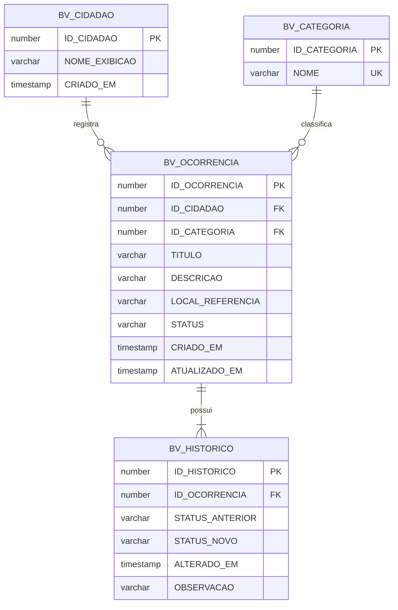
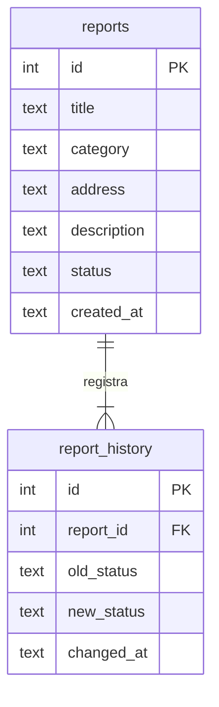

# BairroVivo — MER e DER

## MER (Modelo Entidade-Relacionamento)

**CIDADÃO**: pessoa que cria uma ocorrência no futuro sistema compartilhado.
**CATEGORIA**: classificação padronizada de problema urbano.
**OCORRÊNCIA**: registro com título, descrição, local, situação e datas.
**HISTÓRICO**: evento imutável de entrada ou mudança de situação.

Cardinalidades: um cidadão pode criar zero ou muitas ocorrências (1:N); uma
categoria pode classificar zero ou muitas ocorrências (1:N); uma ocorrência
tem um ou muitos eventos de histórico (1:N). Cada ocorrência pertence a um
cidadão e uma categoria. Cada histórico pertence a uma ocorrência.

## DER (Diagrama Entidade-Relacionamento, modelo Oracle)

### Regras de integridade

- PK em todas as entidades e FK nas associações.
- `BV_OCORRENCIA.STATUS` aceita apenas REGISTRADA, EM_ANALISE,
  EM_ATENDIMENTO e RESOLVIDA (CHECK).
- `BV_PKG_OCORRENCIA.AVANCAR_STATUS` só permite passagem para o próximo estado.
- O histórico registra a transição no mesmo contexto transacional do registro.
- O pacote não efetua COMMIT: a transação é encerrada pelo chamador.
- No aplicativo Flutter offline, não há CIDADÃO nem CATEGORIA como tabela:
  a categoria é uma string no registro; o banco SQLite contém `reports` e
  `report_history`. O Oracle representa uma **arquitetura evolutiva**, não
  uma integração implementada.

## DER do protótipo SQLite efetivamente executado

